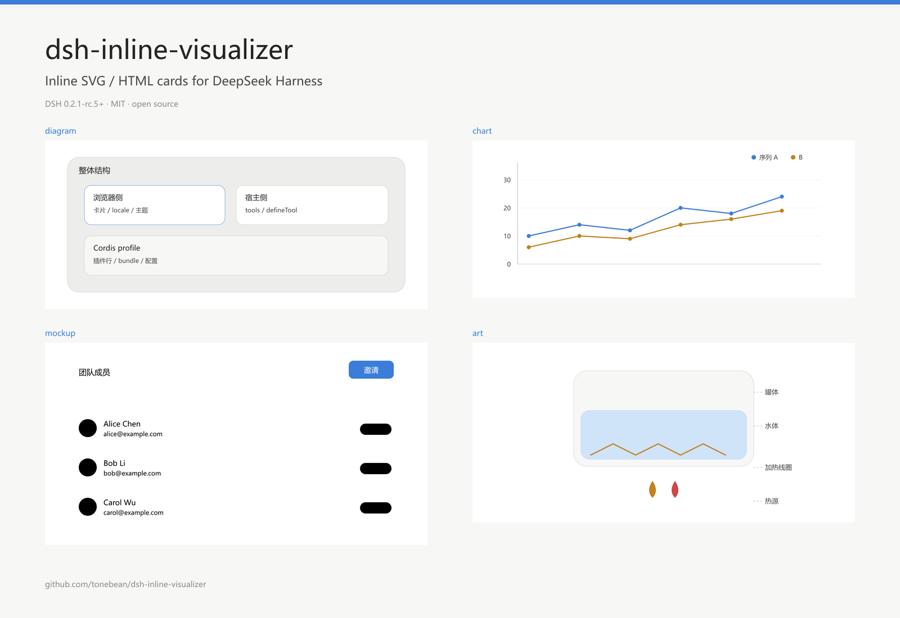
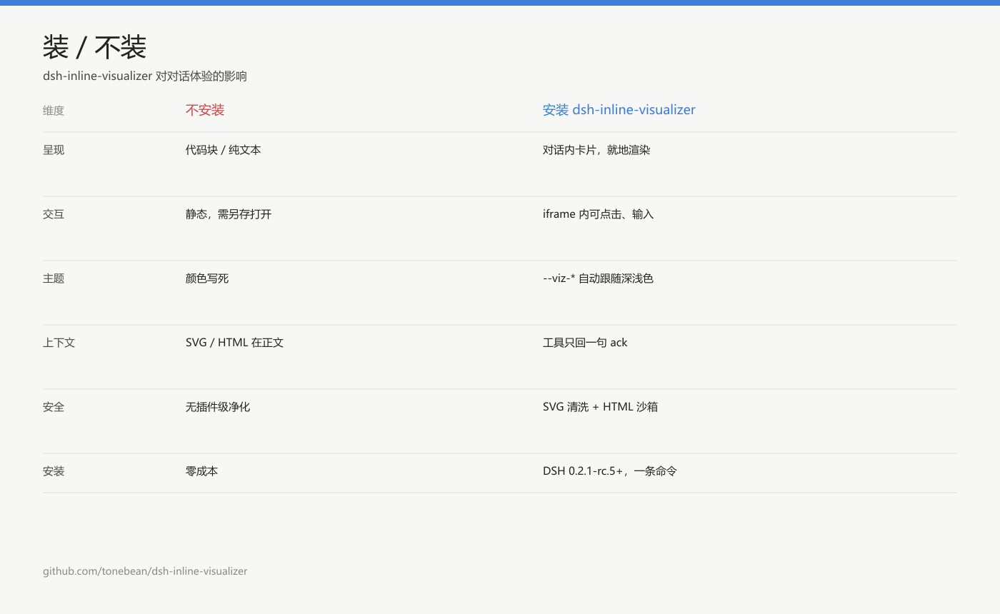

# dsh-inline-visualizer



[](https://www.npmjs.com/package/dsh-inline-visualizer) · [GitHub](https://github.com/tonebean/dsh-inline-visualizer) · MIT · DSH 0.2.1-rc.5

把「内联可视化」变成 DeepSeek Harness 里的两个内置工具：模型先说清要画什么（`widget_guidelines` 加载设计契约），再把片段交给 `show_widget`——**卡片当场渲染在对话里，图本身不进模型上下文**。

- 适用于 **DSH 0.2.1-rc.5**（`engines.dsh: >=0.2.1-rc.5 <0.3.0`）。
- 纯 JavaScript，无构建步骤、无第三方运行时依赖；Host 侧使用宿主提供的 `@deepseek-ai/dsh-tools`，浏览器侧只从宿主模块表取 `react`。

## 装与不装



不安装时，图只能以代码块或文件形式出现；安装后，卡片直接在对话里渲染，可交互、可下载、自动跟随主题。

## 为什么是它

- **产物不进模型上下文**。工具返回值只是一句 ack，图走旁路进 UI。两三张图的 SVG 源码不会灌进对话，模型也不会开始复述代码。
- **无第三方运行时依赖**。没有 echarts、没有 mermaid、没有构建脚本；装完即用。
- **主题真跟随**。只读文档化入口 `ctx.theme` 与 `--dsw-alias-*`，切换深浅色时卡片重算配色；不碰 `data-ds-dark-theme` 这类宿主内部实现，宿主升级不会因此断。
- **两条渲染路径，按风险分开**。SVG 走 `data:` URI 的 ``——矢量、清晰、天然不执行脚本；HTML 走 `sandbox="allow-scripts"` 的不透明源 iframe，带 `default-src 'none'` 的 CSP，能交互但读不到宿主。
- **模型不用猜配色**。内置设计契约：8 色系 × 6 级色阶、语义令牌、排版与硬约束，按模块（diagram / chart / mockup / interactive / art）按需加载。
- **双语界面 + 完整显示元数据**。`locale/{en,zh}.json` 带 `meta.title` / `meta.description`，`icon.svg` 自绘，市场里不会掉成默认图。
- **197 项自测**；启用真实 `dsh-tools` 的 Part C 后共 205 项，包含工具 schema 编译。

## 它不做什么

- **不做流式逐字渲染**：图在工具调用完成后一次出现，不逐 token 生长。
- **不做光栅化**：输出始终是矢量 SVG，不转 PNG。
- **不解析 Mermaid**：要 Mermaid 请另装对应插件。
- **不内置图表库**：图表由模型手写原生 SVG，换来的零依赖与可控体积。

## 两个工具

| 工具 | 参数 | 作用 |
|---|---|---|
| `widget_guidelines` | `modules: ('diagram'\|'chart'\|'mockup'\|'interactive'\|'art')[]` | 返回设计契约（令牌、排版、间距、硬约束 + 所选模块） |
| `show_widget` | `title`, `widget_code`, `loading_messages` | 就地渲染一张卡片；只回一句极短 ack |

`widget_code` 是裸 `<svg …>…</svg>`（首选）或一段 HTML 片段。工具返回值里**没有**片段内容——这正是该方案的红线。

## 安装

已发布到 [npm](https://www.npmjs.com/package/dsh-inline-visualizer)（`dsh-inline-visualizer@2.0.2`）。

在 DSH 里用插件管理器安装（推荐）：

```
plugin_manager { action: "install_bundle", target: "dsh-inline-visualizer" }
```

该操作需要 `danger-full-access` 审批；`target` 传 pnpm 可识别的安装 spec——包名（从 npm 安装）或本地目录的绝对路径均可。

手工装（仅开发时）：把包放进 `$DSH_HOME/profiles/<profile>/node_modules/dsh-inline-visualizer`（例如 `~/.dsh/profiles/desktop/node_modules/dsh-inline-visualizer`），并在该 profile 的 `cordis.patch.yml` 追加：

```yaml
- insert:
    - id: visualizer
      name: 'dsh-inline-visualizer'
```

安装新包可经 HMR 生效；**替换已安装的包必须重启**才能加载新的 JS 代。

## 可选配置

```yaml
- id: visualizer
  name: 'dsh-inline-visualizer'
  config:
    maxCodeChars: 200000     # 单张图上限，1000 ~ 1000000
```

## 安全边界

| 面 | 做法 |
|---|---|
| SVG | 白名单清洗后转 `data:` URI 塞进 ``——`<script>`/`<foreignObject>`/动画元素/`on*` 全部剥除，`href` 只允许 `#`、`data:`；`` 本身不执行脚本 |
| HTML | `sandbox="allow-scripts"`（**不透明源，绝不给 `allow-same-origin`**）+ `default-src 'none'` 的 CSP + 外链只放行 4 个 CDN |
| 高度 | 子页 `postMessage({type:'viz:height'})`，父侧校验 `event.source` 后调整 |
| 主题 | 只读文档化入口：`ctx.theme.getTheme().colorScheme` 与 `theme/change`；不碰任何宿主内部属性 |
| 文案 | 全部走插件自己的 locale 命名空间（`ctx.locale`），中英双语 |

## 目录

| 文件 | 作用 |
|---|---|
| `index.js` | Host 半边：`defineTool` 注册两个工具；按需装配 `guidelines/*.md` |
| `client.js` | 浏览器半边：`window.__ModuleLoader__.load()` 工厂，向 `tool.call.toolview` 按 `key: 'show_widget'` 注册卡片 |
| `guidelines/` | 设计契约正文（`_core.md` 必带 + 五个模块） |
| `locale/{en,zh}.json` | 显示元数据（`meta.title`/`meta.description`）与运行期词条 |
| `icon.svg` | 插件图标（64×64，随包发布） |
| `assets/icon-180.png` | 市场卡片图标（180×180 PNG，仅列表用） |
| `assets/readme-hero.png` | README 顶部展示图（随包发布） |
| `assets/readme-compare.png` | 装/不装对比图（随包发布） |
| `test/smoke.mjs` | `npm test`：197 项断言（启用 Part C 后 205 项），含真实 `defineTool` schema 编译 |
| `CHANGELOG.md` | 版本记录 |

## 测试

```bash
npm test
```

分四部分：Host 半边的工具定义、用**真实** `dsh-tools` 编译 schema（`DSH_TOOLS_ENTRY` 指向其 `lib/index.js` 或 `lib/types/schema.js` 时启用）、浏览器半边的渲染/XSS/主题、以及打包与发布要求。

视觉测试用例与截图见 [docs/test-cases](https://github.com/tonebean/dsh-inline-visualizer/tree/main/docs/test-cases)：覆盖 5 个设计模块、两条渲染路径、安全净化与参数校验，共 30 个用例、24 张截图，并附完整冒烟测试报告。

## 已知限制

- **没有真实浏览器 E2E**：`test` 用假 React + 假 DOM，覆盖不到布局、CSP 实际生效、React 调和。
- **净化是正则级**：mXSS、实体编码绕过不在覆盖范围内；SVG 走 `` 已把风险压到最低，但 HTML 分支只剩 CSP 一道防线。
- **规范是通用重写版**：调色板自研 8 色系 × 6 级，不是任何产品的等价复制。
- 接近 1,000,000 字符的配置上限时未做性能验证。

## 发布

1. `npm publish --access public`（包名 `dsh-inline-visualizer`；被占用时改 scoped，并同步三处名称）。
2. 到 [awesome-dsh-plugin](https://github.com/awesome-dsh-plugin/awesome-dsh-plugin) 提一条 PR：**只加一个文件** `data/plugins/tonebean__dsh-inline-visualizer.yml`，分类 `ui`，图标用仓库里的 `assets/icon-180.png`（只收 PNG 位图）。
3. 或自建索引：任意 http(s) 上的 format 1 JSON，用户在「设置 → 插件 → 市场索引」里添加 URL。

完整的命令、验收清单、PR 模板与 semver 陷阱见 `PUBLISHING.md`（不随包发布）。

## 许可

MIT，见 `LICENSE`。
