# 内联可视化测试用例

本目录是 `dsh-inline-visualizer` v2.0.1 的视觉/接口测试记录，运行于 DSH `0.2.1-rc.5`。

- 覆盖 5 个设计模块：`diagram` / `chart` / `mockup` / `interactive` / `art`
- 覆盖两条渲染路径：SVG（data-URI ``）与 HTML（`sandbox="allow-scripts"` iframe）
- 覆盖安全管理与参数校验
- 截图由各用例的 token 版本替换为同主题 hex 值后渲染为 PNG（2×，1360px 宽）

## 测试矩阵

| # | 用例 | 模块 | 路径 | 结果 |
|---|---|---|---|---|
| 1 | 三节点流程 | diagram | SVG | ✅ |
| 2 | 五柱柱状图 | chart | SVG | ✅ |
| 3 | 通知设置表单（含错误态/开关） | mockup | HTML | ✅ |
| 4 | 交互计数器（原生 JS） | interactive | HTML | ✅ |
| 5 | 分层抽象插画 | art | SVG | ✅ |
| 6 | SVG 净化（script/onload/foreignObject） | — | SVG | ✅ |
| 7 | HTML 沙箱隔离（DOM/localStorage/fetch） | — | HTML | ✅ |
| 8 | 五模块契约同时加载 | — | API | ✅ 11938 字符，rejected=[] |
| 9 | 非法模块名 | — | API | ✅ 被 schema 拒绝 |
| 10 | 空 widget_code | — | API | ✅ 被拒绝 |
| 11 | 未闭合 SVG | — | API | ✅ 被拒绝 |
| 12 | 纯文本 | — | API | ✅ 被拒绝 |
| 13 | title/loading_messages 规范化 | — | API | ✅ 文件名与 5 条上限正确 |
| 14 | 结构图（浏览器/宿主/profile） | diagram | SVG | ✅ |
| 15 | 分支流程（缓存命中） | diagram | SVG | ✅ |
| 16 | 折线图（双序列） | chart | SVG | ✅ |
| 17 | 饼图（四扇区） | chart | SVG | ✅ |
| 18 | 散点图（两组） | chart | SVG | ✅ |
| 19 | 团队成员列表 | mockup | HTML | ✅ |
| 20 | 输入框四态 | mockup | HTML | ✅ |
| 21 | 通知偏好开关 | interactive | HTML | ✅ |
| 22 | 三步向导 | interactive | HTML | ✅ |
| 23 | 热水器剖面 | art | SVG | ✅ |
| 24 | 漏斗与三个桶 | art | SVG | ✅ |
| 25 | 温度梯度 | art | SVG | ✅ |
| 26 | SVG 净化矩阵 | security | SVG | ✅ |
| 27 | HTML 沙箱安全矩阵 | security | HTML | ✅ |
| 28 | 主题令牌（浅/深） | theme | SVG | ✅ 2 张 |
| 29 | 多字母标签回归 | api | HTML | ✅ |
| 30 | 超长 widget_code | api | API | ✅ 被拒绝 |

## 截图

### 1. diagram


### 2. chart


### 3. mockup


### 4. interactive


### 5. art


### 6. SVG 净化

输入包含 `<script>`、`onload` 和 `<foreignObject>`；下图是净化后应保留的安全内容。


### 7. HTML 沙箱隔离

图中的三项是 iframe 内脚本运行后的预期结果：宿主 DOM 访问被拦截、`localStorage` 不可用、网络请求被 CSP 拦截。


### 14. diagram 结构图

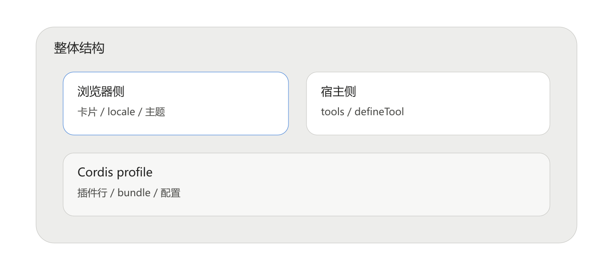

### 15. diagram 分支流程

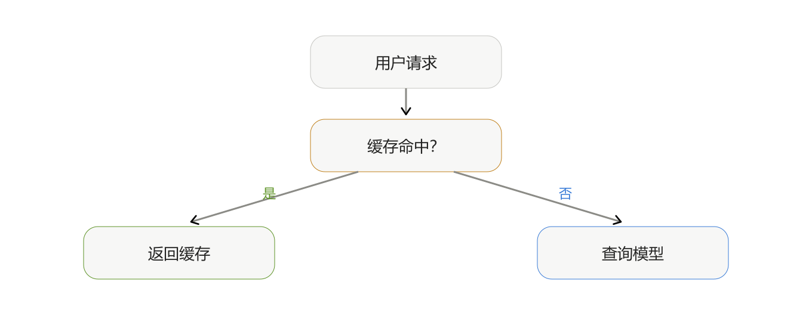

### 16. chart 折线图

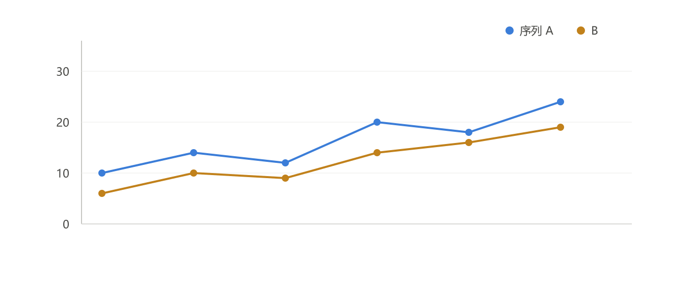

### 17. chart 饼图

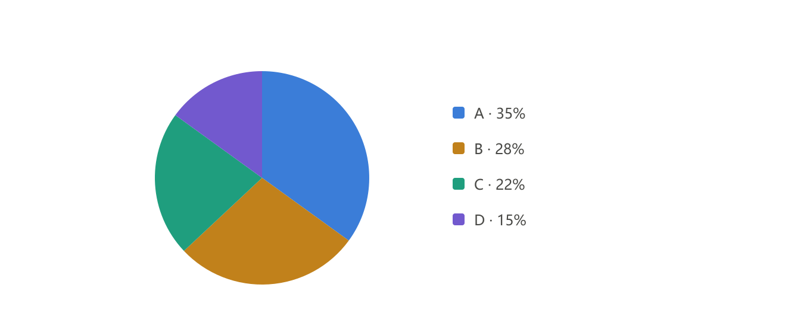

### 18. chart 散点图

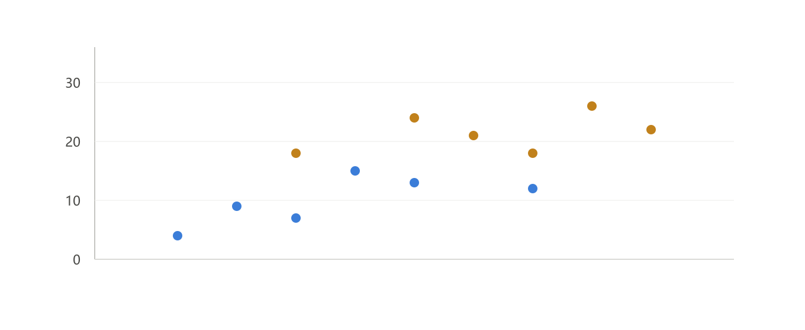

### 19. mockup 列表页

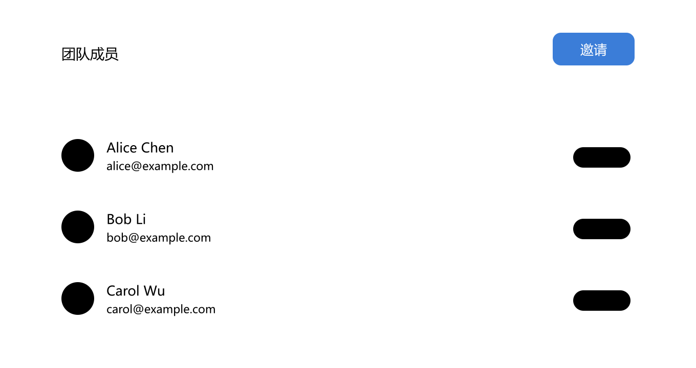

### 20. mockup 输入框四态

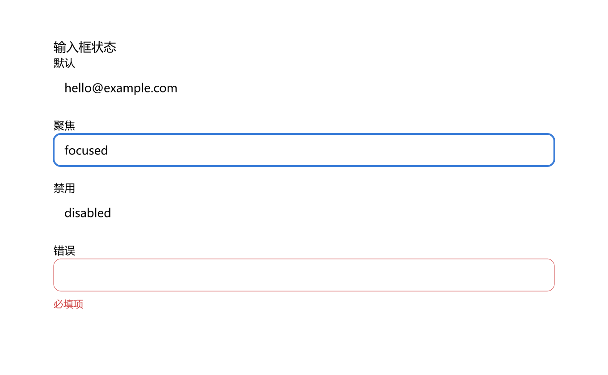

### 21. interactive 开关面板

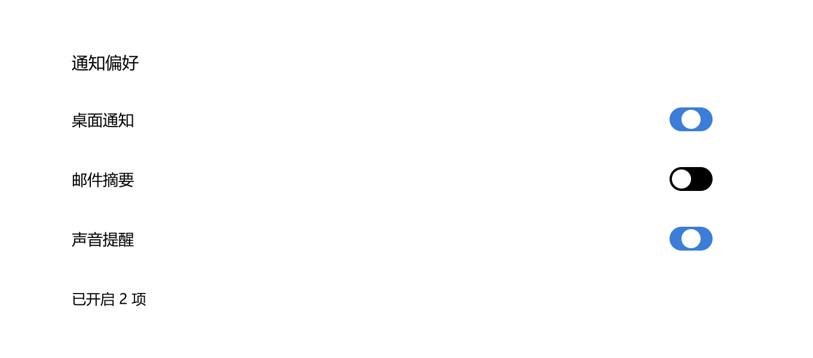

### 22. interactive 三步向导

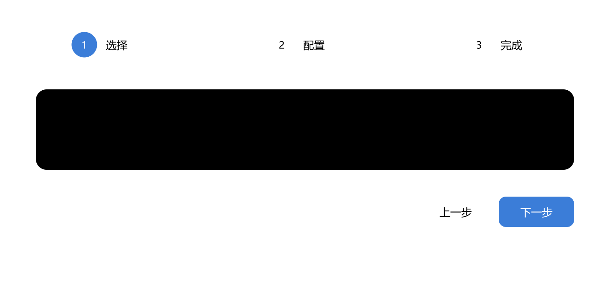

### 23. art 热水器剖面

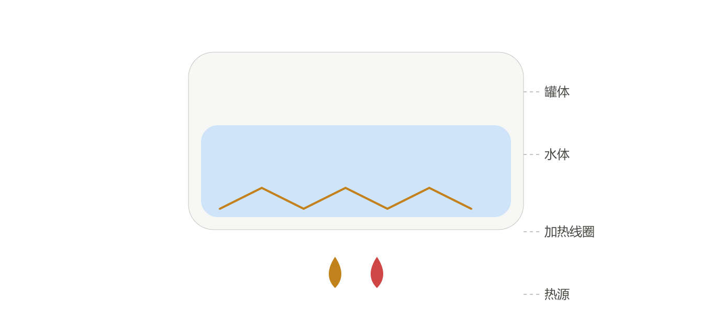

### 24. art 漏斗隐喻

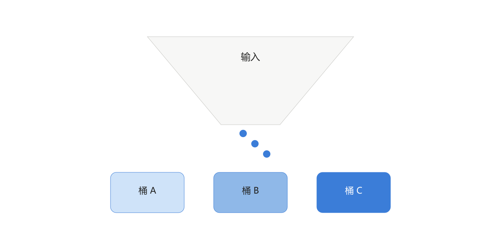

### 25. art 温度梯度

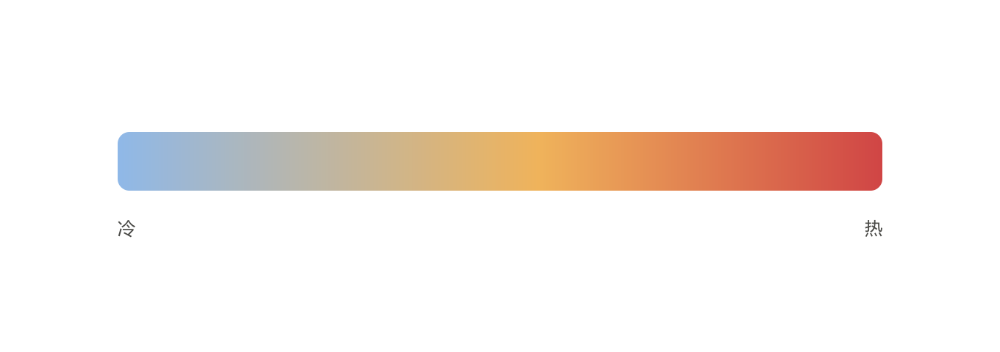

### 26. SVG 净化矩阵

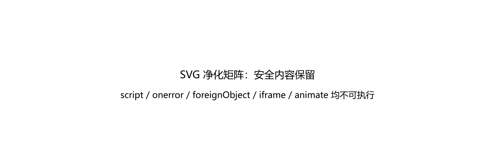

### 27. HTML 沙箱安全矩阵

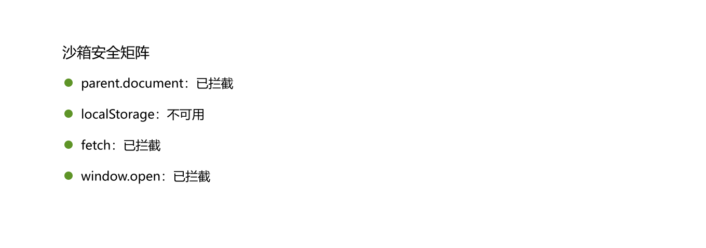

### 28. 主题令牌（浅色 / 深色）

浅色：

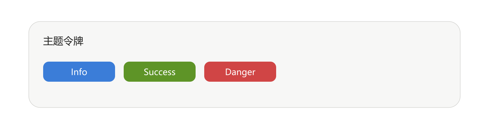

深色：

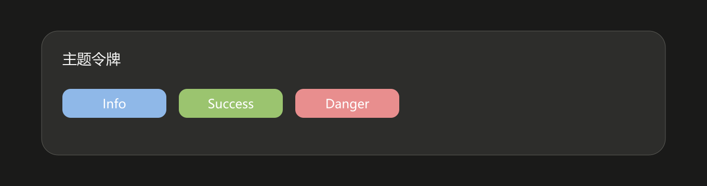

### 29. 多字母标签回归

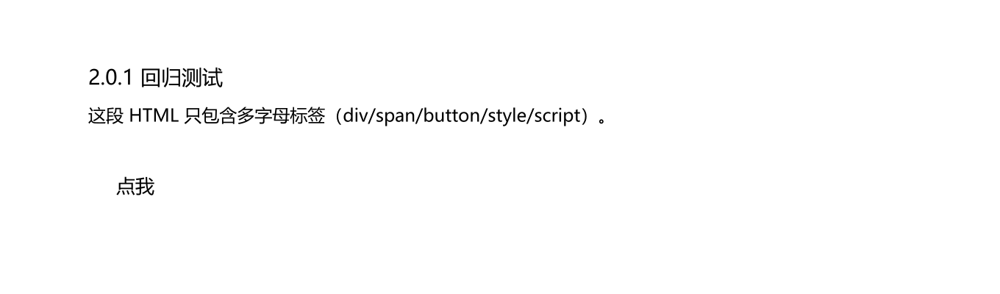

## 复现

- `samples/` 下是对应 `show_widget` 的 `widget_code` 原文（token 版本）。
- 在 DSH 中安装插件后，直接调用：

```js
show_widget({ title: "…", widget_code: "<samples 内容>" })
```

- `mockup` 与 `interactive` 走 HTML iframe；其余走 SVG ``。
- 截图生成使用宿主自带的 `sharp`，将 token 版本替换为同主题 hex 值后以 2× 渲染。

## 已知问题（v2.0.0）

`index.js` 的 HTML 可渲染校验：

```js
if (kind === 'html' && !/<\w[\s>]/.test(code)) throw new Error('widget_code 里没有可渲染的元素。')
```

`\w` 只匹配一个字符，导致 `<div …>`、`<button …>`、`<h2 …>` 等普通标签被误判。本套用例中的 mockup 通过加入 `<p>` 规避。建议改为：

```js
/<[a-z][a-z0-9-]*[\s>\/]/i
```

## 环境

- 插件：`dsh-inline-visualizer@2.0.1`
- 宿主：`dsh 0.2.1-rc.5`（win32）
- 生成时间：2026-10-31

## 冒烟测试

插件自带 `test/smoke.mjs` 完整报告见 [smoke-report.txt](smoke-report.txt)。

```text
TOTAL: 205/205 passed, 0 failed
```

其中 Part C 使用宿主真实的 `@deepseek-ai/dsh-tools` schema 编译两个工具的 `defineTool` 定义。
